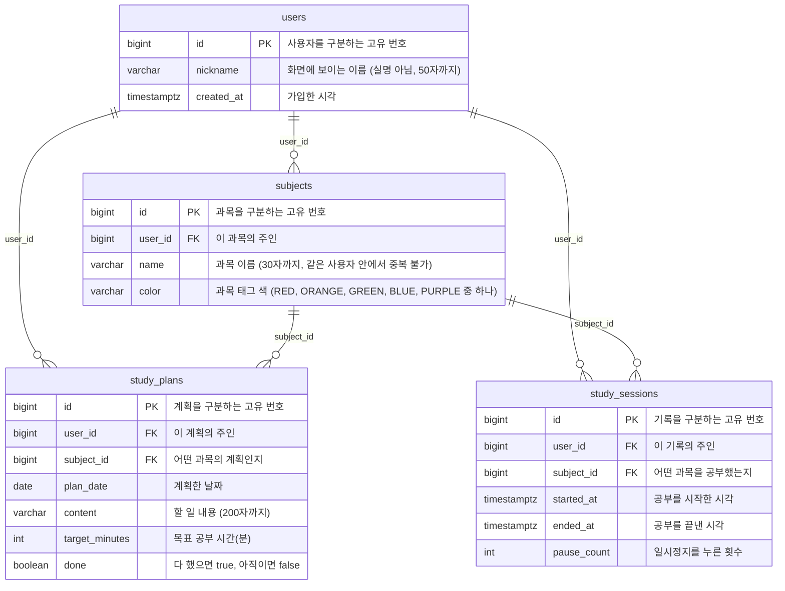

# DB 다이어그램

우리 DB 에 어떤 테이블이 있고 서로 어떻게 이어지는지 **그림 한 장**으로 보는 문서입니다.

- 테이블은 각 기능을 맡은 사람이 **직접 설계**합니다.
- 테이블(엔티티)을 만들거나 고칠 때마다 Claude Code 에서 **`/db`** 를 치면, 지금 엔티티를 읽어 아래 그림을 새로 그리고 브라우저로도 열어 줍니다.
- GitHub 에서 이 문서를 열면 그림으로 보입니다.

## 지금 테이블

<!-- DB-DIAGRAM:START — /db 명령이 이 사이를 새로 씁니다 -->

<!-- DB-DIAGRAM:END -->

## 테이블 설명

| 테이블 | 무엇을 담나 | 만든 이슈 |
| ------ | ----------- | --------- |
| `users` | 서비스를 쓰는 사람 한 명이 한 줄 (별명, 가입 시각) | #3 |
| `subjects` | 사용자가 만든 과목 하나가 한 줄 (이름, 색) | #3 |
| `study_plans` | 하루의 공부 계획 하나가 한 줄 (날짜, 과목, 내용, 목표 시간, 완료 여부) | #3 |
| `study_sessions` | 타이머로 한 번 공부한 기록 하나가 한 줄 (과목, 시작·끝 시각, 일시정지 횟수) | #3 |

## 그림 읽는 법

- **네모 하나 = 테이블 하나 = 엔티티 클래스 하나**
- **선** `||--o{` = "왼쪽 하나가 오른쪽 여러 개를 가진다" (예: 사용자 한 명이 메모 여러 개)
- **PK** = 그 줄을 구분하는 고유 번호
- **FK** = 다른 테이블의 줄을 가리키는 번호 (예: `user_id` 는 `users` 의 어느 줄인지)
- ⚠️ 지금은 DB 가 FK **제약**을 걸지 않습니다. (엔티티에 `Long userId` 처럼 번호만 적기 때문입니다)
  그래서 "없는 사용자", "남의 과목" 이 붙지 않게 하는 검사는 **API 쪽(#10~#13)에서** 합니다.

## 실제로 만들어진 모양 보기

그림은 엔티티 코드를 읽어 그린 것입니다. DB 에 **실제로** 만들어진 테이블은 서버를 켠 뒤 여기서 봅니다.

👉 http://localhost:8080/h2-console (`JDBC URL` 에 `jdbc:h2:mem:projectbe`, `User Name` 에 `sa`)
