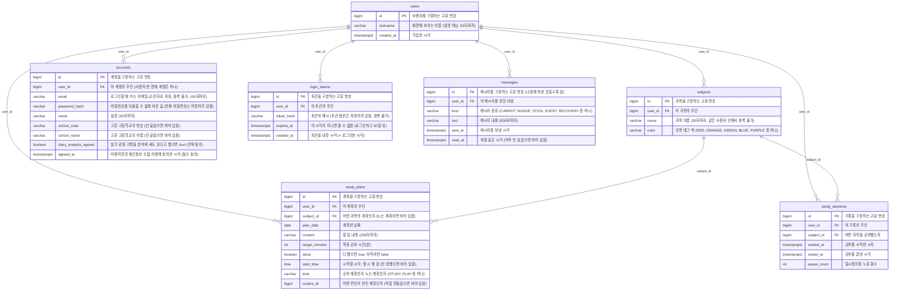

# DB 다이어그램

우리 DB 에 어떤 테이블이 있고 서로 어떻게 이어지는지 **그림 한 장**으로 보는 문서입니다.

- 테이블은 각 기능을 맡은 사람이 **직접 설계**합니다.
- 테이블(엔티티)을 만들거나 고칠 때마다 Claude Code 에서 **`/db`** 를 치면, 지금 엔티티를 읽어 아래 그림을 새로 그리고 브라우저로도 열어 줍니다.
- GitHub 에서 이 문서를 열면 그림으로 보입니다.

## 지금 테이블

<!-- DB-DIAGRAM:START — /db 명령이 이 사이를 새로 씁니다 -->

<!-- DB-DIAGRAM:END -->

## 테이블 설명

| 테이블 | 무엇을 담나 | 만든 이슈 |
| ------ | ----------- | --------- |
| `users` | 서비스를 쓰는 사람 한 명이 한 줄 (별명, 가입 시각) | #3 |
| `subjects` | 사용자가 만든 과목 하나가 한 줄 (이름, 색) | #3 |
| `study_plans` | 하루의 계획 하나가 한 줄 (날짜, 과목, 내용, 목표 시간, 완료 여부, 시작 시각, 공부/노는 계획, 루틴) | #3 · #12 |
| `study_sessions` | 타이머로 한 번 공부한 기록 하나가 한 줄 (과목, 시작·끝 시각, 일시정지 횟수) | #3 |
| `accounts` | 이메일로 가입한 계정 하나가 한 줄 (이메일, 비밀번호 해시, 실명, 학교, 동의). 사용자 한 명에 하나 | #97 |
| `login_tokens` | 로그인 한 번으로 내준 토큰 하나가 한 줄 (토큰 해시, 끝나는 시각) | #97 |
| `messages` | AI 가 사용자에게 보낸 메시지 하나가 한 줄 (종류, 내용, 보낸 시각, 읽은 시각) | #30 |

> `accounts` 와 `login_tokens` 는 2026-10-11 에 SNS 로그인을 빼고 일반 로그인으로 정하면서 **선생님 요청으로 AI 가 먼저 만든 테이블**입니다.
> 학생이 설계한 `users` 는 그대로 두려고 로그인 정보를 따로 뺐습니다. 고칠 점이 보이면 이슈로 남겨 주세요.

> `messages` 는 2026-10-12 에 이슈 #30 을 만들면서 **AI 가 초안을 먼저 만든 테이블**입니다. (사용자가 "AI 가 초안을 만들어 달라" 고 해서 예외로 했습니다)
> 이슈 완료 조건에 적힌 것(종류, 보낸 시각, 읽은 시각, 주인)에 메시지 내용 글자(`text`)만 더했습니다.
> FE 의 `AiMessage` 에 있는 `careLevel`(관리 강도), `eventLabel`(이벤트 이름), `source`(AI/앱) 는 **아직 담지 않았습니다.** 필요한지는 위 그림을 보고 정해 주세요.

> `study_plans` 의 `start_time` · `kind` · `routine_id` 는 2026-10-12 에 이슈 #12 에서 더했습니다. (칸 이름과 뜻은 Project#12 의 표, 시작 시각을 `time` 으로 저장하는 것은 학생이 정함)
> - 공부 계획(`STUDY`)은 `subject_id` 가 꼭 있어야 하고, 노는 계획(`PLAY`)만 비어도 됩니다. DB 에도 검사 규칙(`ck_study_plans_study_has_subject`)으로 걸어 두었습니다.
> - 루틴 테이블은 아직 없어서(#85) `routine_id` 는 지금 항상 비어 있고, 그림에 선도 없습니다.

## 그림 읽는 법

- **네모 하나 = 테이블 하나 = 엔티티 클래스 하나**
- **선** `||--o{` = "왼쪽 하나가 오른쪽 여러 개를 가진다" (예: 사용자 한 명이 메모 여러 개)
- **PK** = 그 줄을 구분하는 고유 번호
- **FK** = 다른 테이블의 줄을 가리키는 번호 (예: `user_id` 는 `users` 의 어느 줄인지)
- ⚠️ 지금은 DB 가 FK **제약**을 걸지 않습니다. (엔티티에 `Long userId` 처럼 번호만 적기 때문입니다)
  그래서 "없는 사용자", "남의 과목" 이 붙지 않게 하는 검사는 **API 쪽(#10~#13)에서** 합니다.

## 실제로 만들어진 모양 보기

그림은 엔티티 코드를 읽어 그린 것입니다. DB 에 **실제로** 만들어진 테이블은 서버를 켠 뒤 여기서 봅니다.

👉 http://localhost:8080/h2-console (`JDBC URL` 에 `jdbc:h2:mem:projectbe`, `User Name` 에 `sa`)
