# DB 다이어그램

우리 DB 에 어떤 테이블이 있고 서로 어떻게 이어지는지 **그림 한 장**으로 보는 문서입니다.

- 테이블은 각 기능을 맡은 사람이 **직접 설계**합니다.
- 테이블(엔티티)을 만들거나 고칠 때마다 Claude Code 에서 **`/db`** 를 치면, 지금 엔티티를 읽어 아래 그림을 새로 그리고 브라우저로도 열어 줍니다.
- GitHub 에서 이 문서를 열면 그림으로 보입니다.

## 지금 테이블

```mermaid
erDiagram
    users ||--o{ subjects : "user_id"
    users ||--o{ study_plans : "user_id"
    users ||--o{ study_sessions : "user_id"
    users ||--o{ accounts : "user_id"
    users ||--o{ login_tokens : "user_id"
    users ||--o{ messages : "user_id"
    users ||--o{ call_records : "user_id"
    users ||--o{ thinking_tests : "user_id"
    users ||--o{ push_subscriptions : "user_id"
    users ||--o{ onboarding_answers : "user_id"
    users ||--o| initial_plans : "user_id"
    thinking_tests ||--o{ thinking_test_scores : "thinking_test_id"
    thinking_tests ||--o{ thinking_test_weaknesses : "thinking_test_id"
    onboarding_answers ||--o{ onboarding_answer_failure_causes : "onboarding_answer_id"
    onboarding_answers ||--o{ onboarding_answer_subject_levels : "onboarding_answer_id"
    subjects ||--o{ study_plans : "subject_id"
    subjects ||--o{ study_sessions : "subject_id"
    subjects ||--o{ onboarding_answer_subject_levels : "subject_id"
    users ||--o{ exams : "user_id"
    users ||--o{ exam_scores : "user_id"
    exams ||--o{ exam_scores : "exam_id"
    subjects ||--o{ exam_scores : "subject_id"
    users ||--o| care_settings : "user_id"
    users ||--o{ focus_lock_apps : "user_id"
    users ||--o{ setting_changes : "user_id"

    users {
        bigint id PK "사용자를 구분하는 고유 번호"
        varchar nickname "화면에 보이는 이름 (실명 아님, 50자까지)"
        timestamptz created_at "가입한 시각"
    }
    subjects {
        bigint id PK "과목을 구분하는 고유 번호"
        bigint user_id FK "이 과목의 주인"
        varchar name "과목 이름 (30자까지, 같은 사용자 안에서 중복 불가)"
        varchar color "과목 태그 색 (RED, ORANGE, GREEN, BLUE, PURPLE 중 하나)"
    }
    study_plans {
        bigint id PK "계획을 구분하는 고유 번호"
        bigint user_id FK "이 계획의 주인"
        bigint subject_id FK "어떤 과목의 계획인지 (노는 계획이면 비어 있음)"
        date plan_date "계획한 날짜"
        varchar content "할 일 내용 (200자까지)"
        int target_minutes "목표 공부 시간(분)"
        boolean done "다 했으면 true, 아직이면 false"
        time start_time "시작할 시각, 몇 시 몇 분 (안 정했으면 비어 있음)"
        varchar kind "공부 계획인지 노는 계획인지 (STUDY, PLAY 중 하나)"
        bigint routine_id "어떤 루틴이 만든 계획인지 (직접 만들었으면 비어 있음)"
    }
    study_sessions {
        bigint id PK "기록을 구분하는 고유 번호"
        bigint user_id FK "이 기록의 주인"
        bigint subject_id FK "어떤 과목을 공부했는지 (노는 기록이면 비어 있음)"
        timestamptz started_at "공부를 시작한 시각"
        timestamptz ended_at "공부를 끝낸 시각"
        int pause_count "일시정지를 누른 횟수"
        bigint paused_ms "일시정지해 있던 시간의 합, 밀리초 (없으면 0, 순공에서 뺌)"
        bigint plan_id "어느 계획을 하려고 켠 타이머인지 (계획 없이 켰으면 비어 있음)"
        int target_minutes "시작할 때 약속한 목표 시간(분) (목표 없이 켰으면 비어 있음)"
        varchar stop_reason "목표 전에 그만둔 이유 (TIRED, EVENT, PHONE, TOO_MUCH, UNWILLING, SICK, ETC 중 하나, 안 골랐으면 비어 있음)"
        varchar kind "공부 기록인지 노는 기록인지 (STUDY, PLAY 중 하나)"
    }
    accounts {
        bigint id PK "계정을 구분하는 고유 번호"
        bigint user_id FK "이 계정의 주인 (사용자 한 명에 계정은 하나)"
        varchar email "로그인할 때 쓰는 이메일 (소문자로 저장, 중복 불가, 100자까지)"
        varchar password_hash "비밀번호를 되돌릴 수 없게 바꾼 값 (진짜 비밀번호는 저장하지 않음, 구글로 가입했으면 비어 있음)"
        varchar google_subject "구글로 가입했으면 구글이 정해 준 고유 번호 (중복 불가, 이메일로 가입했으면 비어 있음)"
        varchar name "실명 (20자까지)"
        varchar school_code "고른 고등학교의 번호 (안 골랐으면 비어 있음)"
        varchar school_name "고른 고등학교의 이름 (안 골랐으면 비어 있음)"
        boolean diary_analysis_agreed "일기·감정 기록을 분석에 써도 된다고 했으면 true (선택 동의)"
        timestamptz agreed_at "이용약관과 개인정보 수집·이용에 동의한 시각 (필수 동의)"
    }
    login_tokens {
        bigint id PK "토큰을 구분하는 고유 번호"
        bigint user_id FK "이 토큰의 주인"
        varchar token_hash "토큰의 해시 (토큰 원문은 저장하지 않음, 중복 불가)"
        timestamptz expires_at "이 시각이 지나면 쓸 수 없음 (로그인하고 30일 뒤)"
        timestamptz created_at "토큰을 내준 시각 (= 로그인한 시각)"
    }
    messages {
        bigint id PK "메시지를 구분하는 고유 번호 (나중에 보낸 것일수록 큼)"
        bigint user_id FK "이 메시지를 받은 사람"
        varchar kind "메시지 종류 (CARROT, NUDGE, STICK, EVENT, RECOVERY 중 하나)"
        varchar text "메시지 내용 (500자까지)"
        timestamptz sent_at "메시지를 보낸 시각"
        timestamptz read_at "처음 읽은 시각 (아직 안 읽었으면 비어 있음)"
    }
    call_records {
        bigint id PK "통화를 구분하는 고유 번호"
        bigint user_id FK "이 통화를 한 사람"
        date call_date "통화한 날 (새벽 4시에 날짜가 바뀜)"
        timestamptz started_at "통화를 시작한 시각 (임시 키를 받은 시각)"
        varchar asked_bias "이번 통화에서 확인하려던 생각 습관 (PLANNING_FALLACY, FUTURE_SELF, WHAT_THE_HELL, EMOTIONAL_REASONING, EXTERNAL_BLAME, ALL_OR_NOTHING, MORAL_LICENSING, OVERGENERALIZING 중 하나, 없으면 비어 있음)"
        varchar asked_question_key "고른 기본 질문의 이름 (예: PLANNING_FALLACY-1)"
        timestamptz finished_at "통화를 마무리한 시각 (마무리 전이면 비어 있음)"
        varchar summary "통화 요약 2~3문장 (300자까지, 대화 원문은 저장하지 않음)"
        varchar found_bias "대답에서 보인 생각 습관 (asked_bias 와 같은 값 중 하나, 없으면 비어 있음)"
        varchar found_evidence "그 습관이 보인 근거 한 줄 (100자까지)"
        varchar actual_question "AI 가 실제로 한 생각 습관 질문 (200자까지)"
        varchar miss_reason "어제 계획을 못 채운 이유 (TIRED, EVENT, PHONE, TOO_MUCH, UNWILLING, SICK, ETC 중 하나)"
        varchar promise_if "오늘의 약속 '만약 ~하면' (50자까지)"
        varchar promise_then "오늘의 약속 '~한다' (50자까지)"
        boolean promise_kept "지난 약속을 지켰다고 했는지 (이야기하지 않았으면 비어 있음)"
        boolean crisis_detected "위기 표현이 감지됐는지 (감지되면 내용 칸은 비워 둠)"
    }
    thinking_tests {
        bigint id PK "테스트 결과를 구분하는 고유 번호 (나중에 한 것일수록 큼)"
        bigint user_id FK "테스트를 한 사람"
        timestamptz taken_at "테스트를 마친 시각"
        int test_version "테스트 모양 번호 (2 = 리커트 7점 척도)"
    }
    thinking_test_scores {
        bigint thinking_test_id FK "어느 테스트의 점수인지"
        varchar habit "생각 습관 이름 (PLANNING_FALLACY 등 8개 중 하나)"
        double average "그 습관의 평균 (1 ~ 7, 역문항은 뒤집어 센 값)"
    }
    push_subscriptions {
        bigint id PK "구독을 구분하는 고유 번호"
        bigint user_id FK "알림을 받을 사람"
        varchar endpoint "푸시를 보낼 브라우저 회사의 주소 (500자까지, 중복 불가, 기기마다 하나)"
        varchar p256dh "알림 내용을 잠그는 브라우저의 공개 열쇠 (200자까지)"
        varchar auth "알림 내용을 잠그는 비밀 값 (100자까지)"
        timestamptz subscribed_at "구독을 저장한(다시 저장한) 시각"
    }
    thinking_test_weaknesses {
        bigint thinking_test_id FK "어느 테스트의 약점인지"
        varchar weakness "내가 꼽은 약점 칩 (GAME, PHONE, VIDEO, SLEEP, LAZY, DELAY, FOCUS, FRIENDS, TIRED, MOOD, PLANNING 중 하나)"
    }
    onboarding_answers {
        bigint id PK "설문을 구분하는 고유 번호"
        bigint user_id FK "누구의 설문인지"
        timestamptz answered_at "답한 시각 (가장 처음 줄과 가장 최근 줄을 이것으로 구분)"
        varchar grade "학년 (HIGH_1, HIGH_2, HIGH_3, REPEATER, UNIVERSITY 중 하나)"
        varchar target_exam "목표로 하는 시험 이름 (30자까지)"
        date target_exam_date "목표 시험 날짜 (D-day 계산용)"
        varchar target_university "목표 대학 (30자까지, 비어 있을 수 있음)"
        varchar target_score "목표 점수 (30자까지, 비어 있을 수 있음)"
        time wake_up_time "평소 기상 시각"
        time sleep_time "평소 취침 시각"
        time school_end_time "학교 끝나는 시각"
        time academy_end_time "학원 끝나는 시각"
        varchar study_place "주로 공부하는 장소 (HOME, SCHOOL, ACADEMY, LIBRARY, CAFE, OTHER 중 하나)"
        varchar chronotype "[자기 인식] 아침형/밤형 (MORNING, NIGHT 중 하나)"
        int max_focus_minutes "[자기 인식] 한 번에 집중 가능한 시간(분) (30, 50, 90, 120 중 하나)"
        varchar biggest_distraction "[자기 인식] 가장 큰 방해 요소 (PHONE, SLEEPY, WANDERING_MIND, PEOPLE, NOISE, OTHER 중 하나)"
        int daily_available_minutes "[자기 인식] 하루 공부 가능 시간(분) (60, 120, 180, 240, 300 중 하나)"
        varchar motivation_reason "공부하는 이유 (50자까지)"
        varchar goal_reward "목표를 이루면 하고 싶은 것 (50자까지)"
    }
    onboarding_answer_failure_causes {
        bigint onboarding_answer_id FK "어느 설문의 답인지"
        varchar cause "계획이 무너졌던 때 (AFTER_EXAM, WEEKEND, LATE_ACADEMY, PHONE, TOO_MUCH_PLAN 중 하나)"
    }
    onboarding_answer_subject_levels {
        bigint onboarding_answer_id FK "어느 설문의 답인지"
        bigint subject_id FK "어떤 과목인지"
        int grade "최근 등급 (1 ~ 9, 점수로 적었으면 비어 있음)"
        int score "최근 점수 (0 ~ 100, 등급으로 적었으면 비어 있음)"
        int confidence "이 과목에 대한 자신감 (1 ~ 5)"
    }
    initial_plans {
        bigint id PK "처음 계획을 구분하는 고유 번호"
        bigint user_id FK "누구의 처음 계획인지 (한 사람에 한 줄, 중복 불가)"
        date created_date "처음 계획을 세운(다시 세운) 날짜"
        int daily_minutes "하루에 공부하기로 한 시간(분) (60, 120, 180, 240, 300 중 하나)"
        int days_per_week "일주일에 며칠 하기로 했는지 (3, 5, 6, 7 중 하나)"
    }
    exams {
        bigint id PK "시험을 구분하는 고유 번호"
        bigint user_id FK "이 시험의 주인"
        varchar name "시험 이름 (50자까지)"
        varchar type "시험 종류 (MOCK, SCHOOL, QUIZ, ETC 중 하나)"
        date exam_date "시험 날짜"
    }
    exam_scores {
        bigint id PK "점수 한 줄을 구분하는 고유 번호"
        bigint user_id FK "이 점수의 주인"
        bigint exam_id FK "어느 시험의 점수인지"
        bigint subject_id FK "어느 과목의 점수인지 (같은 시험에 같은 과목은 한 번만)"
        int expected_score "시험 전에 적은 예상 점수 (0 ~ 100)"
        int actual_score "시험 후에 적은 실제 점수 (0 ~ 100, 아직 안 적었으면 비어 있음)"
    }
    care_settings {
        bigint id PK "설정 한 줄을 구분하는 고유 번호"
        bigint user_id FK "이 설정의 주인 (사용자 한 명에 한 줄, 중복 불가)"
        time call_time "AI 가 전화하는 시각"
        int daily_message_count "하루에 받을 AI 메시지 수 (0 ~ 5)"
        time quiet_start "연락 금지 시작 시각"
        time quiet_end "연락 금지 끝 시각"
        int max_harshness "허용하는 독설 수위 (1 ~ 5)"
        boolean allow_app_lock "앱 잠금(집중 모드)을 허용하는지"
        int max_care_level "지금 적용 중인 제재 한도 (0 ~ 4)"
        int pending_max_care_level "올렸는데 아직 적용 전인 한도 (없으면 비어 있음)"
        date pending_effective_date "바뀔 한도가 적용되는 날짜 (없으면 비어 있음)"
    }
    focus_lock_apps {
        bigint id PK "한 줄을 구분하는 고유 번호"
        bigint user_id FK "이 앱을 고른 사람"
        varchar app_name "잠글 앱 이름 (30자까지, 같은 사용자 안에서 중복 불가)"
    }
    setting_changes {
        bigint id PK "기록 한 줄을 구분하는 고유 번호 (나중에 바꾼 것일수록 큼)"
        bigint user_id FK "설정을 바꾼 사람"
        timestamptz changed_at "바꾼 시각"
        varchar field "바꾼 칸의 이름 (API 의 JSON 이름, 예: maxHarshness)"
        varchar old_value "바꾸기 전 값 (글자, 1000자까지)"
        varchar new_value "바꾼 뒤 값 (글자, 1000자까지)"
    }
```

<!-- DB-DIAGRAM:START — /db 명령이 이 사이를 새로 씁니다 -->

<!-- DB-DIAGRAM:END -->

## 테이블 설명

| 테이블 | 무엇을 담나 | 만든 이슈 |
| ------ | ----------- | --------- |
| `users` | 서비스를 쓰는 사람 한 명이 한 줄 (별명, 가입 시각) | #3 |
| `subjects` | 사용자가 만든 과목 하나가 한 줄 (이름, 색) | #3 |
| `study_plans` | 하루의 계획 하나가 한 줄 (날짜, 과목, 내용, 목표 시간, 완료 여부, 시작 시각, 공부/노는 계획, 루틴) | #3 · #12 |
| `study_sessions` | 타이머로 한 번 잰 기록 하나가 한 줄 (과목, 시작·끝 시각, 일시정지 횟수·시간, 계획, 목표 시간, 그만둔 이유, 공부/노는 기록) | #3 · #13 |
| `accounts` | 가입한 계정 하나가 한 줄 (이메일, 비밀번호 해시 또는 구글 고유 번호, 실명, 학교, 동의). 사용자 한 명에 하나 | #97 · #19 |
| `login_tokens` | 로그인 한 번으로 내준 토큰 하나가 한 줄 (토큰 해시, 끝나는 시각) | #97 |
| `messages` | AI 가 사용자에게 보낸 메시지 하나가 한 줄 (종류, 내용, 보낸 시각, 읽은 시각) | #30 |
| `call_records` | AI 통화 한 번이 한 줄 (확인하려던 생각 습관, 요약, 보인 생각 습관과 근거, 약속, 위기 표현 표시) | #28 · #29 |
| `push_subscriptions` | 웹 푸시(앱을 닫아도 오는 알림)를 받겠다고 한 기기 하나가 한 줄 (보낼 주소, 잠금 열쇠) | #32 |
| `thinking_tests` | 생각 습관 테스트 한 번이 한 줄 (마친 시각, 테스트 모양 번호). 다시 하면 새 줄이 쌓임 | #35 |
| `thinking_test_scores` | 테스트 한 번의 습관 8개 평균이 한 줄씩 (`@ElementCollection`) | #35 |
| `thinking_test_weaknesses` | 테스트 한 번에서 고른 약점 칩이 한 줄씩 (`@ElementCollection`) | #35 |
| `onboarding_answers` | 온보딩 설문 하나가 한 줄. 고칠 때마다 원래 줄을 두고 **새 줄이 쌓임** (처음 답한 자기 인식을 남기려고) | #21 |
| `onboarding_answer_failure_causes` | 설문 하나에서 고른 "계획이 무너진 때" 가 한 줄씩 (`@ElementCollection`) | #21 |
| `onboarding_answer_subject_levels` | 설문 하나의 과목별 최근 성적·자신감이 과목마다 한 줄씩 (`@ElementCollection`) | #21 |
| `initial_plans` | 한 사람의 처음 계획이 한 줄. **한 사람에 한 줄**이고 "다시 세우기" 할 때만 그 줄을 고침 | #21 |
| `exams` | 시험 하나가 한 줄 (이름, 종류, 날짜). 과목별 점수는 `exam_scores` 에 따로 적음 | #16 |
| `exam_scores` | 시험 하나의 과목 하나의 점수가 한 줄 (예상 점수, 실제 점수). 같은 시험에 같은 과목은 한 번만 | #16 |
| `care_settings` | 사용자 한 명의 관리 설정이 한 줄 (전화 시간, 메시지 횟수, 연락 금지, 독설 수위, 앱 잠금, 제재 한도와 바뀔 한도) | #22 |
| `focus_lock_apps` | 한 사용자가 고른 잠금 대상 앱 하나가 한 줄. 같은 사용자 안에서 같은 앱은 한 번만 | #22 |
| `setting_changes` | 설정 칸 하나를 한 번 바꾼 것이 한 줄 (바꾼 시각, 칸 이름, 이전 값, 새 값) | #22 |

> `accounts` 와 `login_tokens` 는 2026-10-11 에 SNS 로그인을 빼고 일반 로그인으로 정하면서 **선생님 요청으로 AI 가 먼저 만든 테이블**입니다.
> 학생이 설계한 `users` 는 그대로 두려고 로그인 정보를 따로 뺐습니다. 고칠 점이 보이면 이슈로 남겨 주세요.

> `messages` 는 2026-10-12 에 이슈 #30 을 만들면서 **AI 가 초안을 먼저 만든 테이블**입니다. (사용자가 "AI 가 초안을 만들어 달라" 고 해서 예외로 했습니다)
> 이슈 완료 조건에 적힌 것(종류, 보낸 시각, 읽은 시각, 주인)에 메시지 내용 글자(`text`)만 더했습니다.
> FE 의 `AiMessage` 에 있는 `careLevel`(관리 강도), `eventLabel`(이벤트 이름), `source`(AI/앱) 는 **아직 담지 않았습니다.** 필요한지는 위 그림을 보고 정해 주세요.

> `call_records` 는 2026-10-14 에 **선생님이 "FE·BE·테이블까지 AI 가 만들라" 고 맡긴 기능**(인지편향 잡기)에서 AI 가 만든 테이블입니다.
> - 통화를 **시작할 때** 한 줄을 만들고(`asked_*`), 통화가 **끝나면** 같은 줄을 채웁니다(`finished_at` 아래 칸들). 마무리하는 API 는 다음 PR(#29)에서 만듭니다.
> - **대화 원문(자막)과 녹음은 저장하지 않습니다.** 요약과 정해진 분류값만 남깁니다. 위기 표현이 감지된 통화는 내용 칸을 비우고 `crisis_detected` 만 남깁니다.
> - 다음 통화는 최근 2주 기록을 읽어 자주 보인 생각 습관을 다시 확인하고, 지난 약속을 지켰는지 묻습니다. 최근 7일 안에 위기 표현이 있었으면 위로하는 통화로 합니다.
> - 체크인(#24) 테이블과 겹치는 칸(못 채운 이유·약속)이 있습니다. 체크인 테이블이 생기면 합칠지 정해 주세요.

> `thinking_tests` 와 딸린 테이블 두 개는 2026-10-15 에 같은 기능(인지편향 잡기)에서 AI 가 만들었습니다.
> - **문장별 답은 저장하지 않고 습관 8개의 평균만** 저장합니다. 테스트 문장은 앞으로 바뀔 수 있어서(선생님 말씀), 문장이 바뀌어도 테이블은 그대로 쓰게 하려는 것입니다.
> - 한 테스트에 점수 8개 · 약점 여러 개라서 **딸린 테이블(`@ElementCollection`)** 에 담았습니다. 엔티티는 `ThinkingTest` 하나이고, JPA 가 두 테이블을 알아서 같이 읽고 씁니다. 그래서 딸린 테이블에는 `id` 가 없습니다.
> - "기타" 에 직접 쓴 약점 글은 서버로 받지 않아서 저장하지 않습니다.

> `onboarding_answers` · 딸린 테이블 두 개 · `initial_plans` 는 2026-10-17 에 이슈 #21 에서 **학생이 설계**했습니다.
> - 한 줄 = 설문 하나. 고치면 원래 줄을 고치지 않고 **새 줄을 더합니다.** 그래야 처음 답한 자기 인식(아침형/밤형 등)이 남아서 #40 에서 실제 기록과 견줄 수 있습니다.
> - 지금 내 설문은 `answered_at` 이 가장 늦은 줄, 처음 자기 인식은 항목마다 **처음으로 답이 있는 줄**에서 꺼냅니다. (온보딩이 짧아져서 아침형/밤형 같은 것은 나중에 처음 답하기 때문)
> - 한 줄에 여러 개인 답(무너진 때 · 과목별 수준)은 `thinking_tests` 처럼 딸린 테이블에 담았습니다.
> - 처음 계획은 규칙이 달라서(온보딩을 다시 해도 안 바뀌고 "다시 세우기" 때만 바뀜) 테이블을 따로 뒀습니다. 한 사람에 한 줄이라 그림의 선이 `||--o|` (0개 또는 1개) 입니다.
> - 엔티티 이름은 `OnboardingAnswer` · `UserInitialPlan` 입니다. (`routine/InitialPlan` 은 루틴 초안 계산 도구라서 이름이 겹치지 않게 했습니다)
> - 과목을 지우면 그 과목의 수준 줄은 DB 에 남지만 응답에서는 빼고 보여 줍니다.

> `exams` 와 `exam_scores` 는 2026-10-17 에 이슈 #16 에서 **학생이 직접 설계한** 테이블입니다. (AI 는 질문으로 도왔고, 칸 이름의 영어 표기만 같이 정했습니다)
> - **시험 하나 = 한 줄, 과목별 점수 = 딸린 테이블.** 과목은 사용자마다 달라서(`subjects`) 시험 표에 `국어 예상` 같은 칸을 미리 만들 수 없고, 시험마다 과목 수도 다르기 때문입니다. (모의고사 3과목, 쪽지시험 1과목)
> - **두 테이블 모두 `user_id` 가 있습니다.** 그래서 탈퇴하면(`AccountService.withdraw`) 코드를 고치지 않아도 시험과 점수가 같이 지워집니다.
> - 실제 점수(`actual_score`)만 비어도 됩니다. 시험 전에는 아직 모르기 때문입니다. 나머지 칸은 꼭 있어야 합니다.
> - 점수는 **0 ~ 100 의 정수**입니다. 같은 시험에 같은 과목은 한 번만(`uk_exam_scores_exam_id_subject_id`) 적을 수 있습니다. 이 둘은 DB 에도 규칙(unique · check)으로 걸어 두었습니다.
> - 시험 종류(`type`)는 이슈에는 3개(모의고사·내신·쪽지시험)였지만 FE 의 `ExamType` 과 화면(#80)에 **기타(`ETC`)** 가 있어서 4개로 정했습니다.
> - 시험 후 회고(`reflection`)는 #17 에서 만듭니다. 아직 칸이 없습니다.

> `care_settings` · `focus_lock_apps` · `setting_changes` 는 2026-10-17 에 이슈 #22 에서 **학생이 직접 설계한** 테이블입니다. (AI 는 질문으로 돕고 영어 이름만 같이 정했습니다)
> - **사용자 한 명의 설정 = 한 줄.** 한 번도 바꾸지 않은 사람은 줄이 없고 처음 값을 보여 줍니다. 처음 바꿀 때 줄이 생깁니다.
> - **제재 한도는 "지금 한도" 와 "바뀔 한도 · 적용 날짜" 를 따로 적습니다.** 높이면 다음 날부터 적용해야 해서, 오늘 값과 내일 값을 둘 다 기억해야 하기 때문입니다. 이 두 칸만 비어도 됩니다.
> - **잠금 대상 앱은 여러 개라서 딸린 테이블**로 뺐습니다. (시험 점수와 같은 이유)
> - **바꾼 기록은 칸 하나를 바꿀 때마다 한 줄**입니다. 값의 모양이 제각각이라 이전 값 · 새 값은 글자로 적습니다. 설정 표는 값을 덮어써서, 옛 값은 여기에만 남습니다.
> - 세 테이블 모두 `user_id` 가 있어서 탈퇴하면 같이 지워집니다.
> - 처음 값은 FE 와 같습니다 (전화 시간 21:00 은 학생이 정함). FE 의 `allowOffHoursCall`(정해진 시간 외 독촉 전화 허용)은 이슈에 없어서 담지 않았습니다.

> `study_plans` 의 `start_time` · `kind` · `routine_id` 는 2026-10-12 에 이슈 #12 에서 더했습니다. (칸 이름과 뜻은 Project#12 의 표, 시작 시각을 `time` 으로 저장하는 것은 학생이 정함)
> - 공부 계획(`STUDY`)은 `subject_id` 가 꼭 있어야 하고, 노는 계획(`PLAY`)만 비어도 됩니다. DB 에도 검사 규칙(`ck_study_plans_study_has_subject`)으로 걸어 두었습니다.
> - 루틴 테이블은 아직 없어서(#85) `routine_id` 는 지금 항상 비어 있고, 그림에 선도 없습니다.

## 그림 읽는 법

- **네모 하나 = 테이블 하나 = 엔티티 클래스 하나**
- **선** `||--o{` = "왼쪽 하나가 오른쪽 여러 개를 가진다" (예: 사용자 한 명이 메모 여러 개)
- **PK** = 그 줄을 구분하는 고유 번호
- **FK** = 다른 테이블의 줄을 가리키는 번호 (예: `user_id` 는 `users` 의 어느 줄인지)
- ⚠️ 지금은 DB 가 FK **제약**을 걸지 않습니다. (엔티티에 `Long userId` 처럼 번호만 적기 때문입니다)
  그래서 "없는 사용자", "남의 과목" 이 붙지 않게 하는 검사는 **API 쪽(#10~#13)에서** 합니다.

## 실제로 만들어진 모양 보기

그림은 엔티티 코드를 읽어 그린 것입니다. DB 에 **실제로** 만들어진 테이블은 서버를 켠 뒤 여기서 봅니다.

👉 http://localhost:8080/h2-console (`JDBC URL` 에 `jdbc:h2:mem:projectbe`, `User Name` 에 `sa`)
